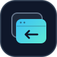

<div align="center">
  
  <h1>EdgeRecentTabs</h1>
  <p><strong>Your recent tabs, one shortcut away.</strong><br>
  A visual tab switcher for Microsoft Edge on macOS.</p>
  <p>
    <a href="#get-started">Get started</a> ·
    <a href="docs/guide.md">Guide</a> ·
    <a href="CHANGELOG.md">Changelog</a> ·
    <a href="LICENSE">MIT license</a>
  </p>
</div>

---

| Recent first | See before you switch | Only in Edge |
| :--- | :--- | :--- |
| Tabs in the order you last used them. | Cached page previews and site icons. | Your shortcut stays out of other apps. |

Hold **⌥ Option**, press **Tab**, then release **⌥** to switch.
Choose **2–25 tabs** and **current window or all windows** in the extension popup.

## Get started

Requires [Microsoft Edge](https://www.microsoft.com/edge), [Hammerspoon](https://www.hammerspoon.org/), and Python 3 on macOS.

1. Clone or download this repo, then run from its folder:

   ```sh
   python3 scripts/prepare_install.py
   ```

2. Load `dist/init.lua` in Hammerspoon, grant Accessibility access, and **Reload Config**. [Setup details →](docs/guide.md#install)
3. Open `edge://extensions`, enable **Developer mode**, then **Load unpacked** → select `edge-extension`.

Visit a few tabs to fill the preview cache. Keep the extension folder in place.

## Keyboard

| Key | Action |
| :--- | :--- |
| <kbd>⌥</kbd> + <kbd>Tab</kbd> / <kbd>⇧</kbd> + <kbd>⌥</kbd> + <kbd>Tab</kbd> | Cycle forward / backward |
| Arrow keys / <kbd>1</kbd>–<kbd>9</kbd> | Select a card |
| Release <kbd>⌥</kbd> | Switch to the selected tab |
| <kbd>Esc</kbd> | Cancel |

---

[Updating & troubleshooting](docs/guide.md#update) · [Development & tests](docs/guide.md#development-and-checks)
